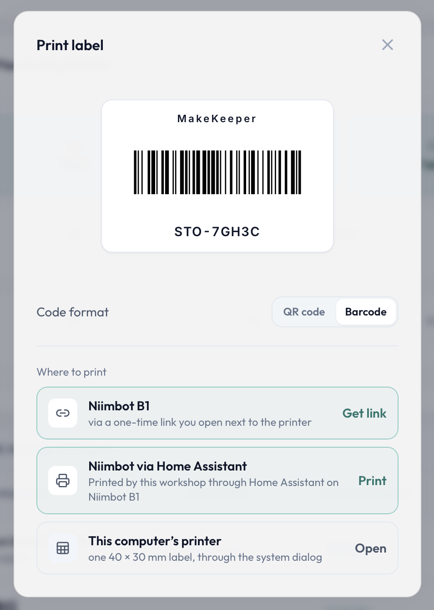

# Changelog

All notable changes to MakeKeeper, newest first. The format follows
[Keep a Changelog](https://keepachangelog.com/en/1.1.0/); versions follow
[Semantic Versioning](https://semver.org/).

This file is rendered from the release tags by `tools/changelog/render.sh` —
each entry is the text of its annotated tag, which is also what the matching
[GitHub Release](https://github.com/makekeeper/makekeeper/releases) shows. Do
not edit it by hand: the next release regenerates it.

## [0.20.0] - 2026-11-02

### The AI assistant works with Claude, and with OpenRouter

- **Anthropic (Claude API) connections now run the assistant.** Before this release an
  Anthropic connection passed its test and then failed on every chat turn. Gateways set up as
  "custom" had the same problem. Both now work, with tools and images.
- **The connection test sends a real message.** Testing a connection checks the key and then
  sends one short message, tools included, to the chosen model. A green test now means the chat
  will work. If you haven't picked a model yet, the test says the chat is not checked instead of
  passing.
- **Pick the model from a list.** The model field offers the models your connection actually has
  access to. You can still type a model id by hand, and the field falls back to free text when the
  provider can't list its models.
- **OpenRouter** is a new connection type: one key gives access to many vendors' models.
- **Errors say what to fix:** a wrong key, an unknown model, an unreachable address, or a model
  your account can't use. The provider's own message is still there underneath.
- The "API version" field on Anthropic connections is gone; the right value is set for you.

**Can I use my Claude, ChatGPT or Gemini subscription instead of an API key?** Not yet, and
for Claude and Gemini not at all: their terms don't allow a third-party app to use a
subscription. The connection form says so for each of them. OpenAI only allows it through a
partner program, which we are looking into.

### Fixed

- **Label QR codes behind an https proxy.** A printed label's QR code could point at
  `https://<your-host>:80/…` when MakeKeeper runs behind more than one proxy. Labels and the
  one-time print link now use the address you opened the app at. Labels printed before this fix
  keep working only if your instance also answers on port 80; if it doesn't, reprint them.

## [0.19.0] - 2026-10-18

### Print labels straight to a Niimbot B1

A label for an item, a storage cell or a project now goes onto a sticker without a trip through
the system print dialog — which pocket Bluetooth printers never appear in. The label dialog lists
every way to print that this workshop actually has, one row each:

- **Directly from the browser.** In Chrome or Edge, on a desktop or on Android, the app talks to
  the printer over Web Bluetooth: pick it once, and the label prints.
- **Through a one-time link.** Safari and Firefox have no Web Bluetooth. The dialog gives a link
  instead; open it in a Chromium browser on a device next to the printer and the same label
  prints there, no sign-in needed.
- **Through Home Assistant.** If your household runs Home Assistant with the
  [hass-niimbot](https://github.com/eigger/hass-niimbot) integration, connect MakeKeeper to it
  in Settings and print from any device — an iPhone included — with no Bluetooth on the device
  at all.
- **This computer's printer**, through the system dialog, as before.

Labels now carry the MakeKeeper name with the code, set in a face that survives a 203 dpi
thermal head, and what prints is exactly the label on screen. Print density and label stock
are settings of the printer, kept once for the whole instance.

A standalone Bluetooth bridge — a small container that owns the printer and prints for any
device that can reach MakeKeeper — ships separately as its own plugin release.

### A word from the developer

A week after an instance first meets this version, the dashboard shows a small card asking how
MakeKeeper is working for you: a star, a release subscription, a wish or a complaint — any of
them helps decide what comes next. Each person closes it for themselves, for good. The same
question stays available in Settings → About, along with the optional daily ping for whoever
administers the instance.

### Fixed

- **The update checker ignores release candidates.** A prerelease tag is never offered as an
  update.

### Also new

- **This changelog.** It is rendered from the release notes themselves, so this file and the
  GitHub Release always say the same thing. Settings → Version & Updates links to it next to the
  release notes.

Under the hood

- A prerelease plugin tag publishes only its own image tag; `latest` and the `X.Y` series no
  longer move for a candidate.
- A plugin release now lints, builds and tests the whole tree before its image is published,
  as the product release already did.

Install and upgrade instructions: [INSTALL.md](https://github.com/makekeeper/makekeeper/blob/main/INSTALL.md)

## [0.18.2] - 2026-09-12

### The images now run natively on ARM

Every tag — `0.18.2`, `0.18` and `latest` — is published for **`linux/amd64` and
`linux/arm64`**. A Raspberry Pi 5, an Ampere or Graviton VPS, an Apple Silicon machine now
pulls a native image instead of emulating an x86 one, or failing to start where no emulation
was configured.

Nothing changes in how you install or update: the tag is the same, and Docker picks the build
that matches your machine.

The optional MCP plugin image is not part of this release — it has its own version line, and its
next release will carry both architectures as well.

Other architectures — 32-bit ARM, RISC-V — are not published. A host that until now pulled the
x86 image and emulated it will no longer find a matching image.

### Nothing else changed

There are no application changes in this release. It exists so that the ARM images reach you:
support for an architecture only arrives with a tag. An x86 install updating to `0.18.2` gets a
functionally identical build of `0.18.1`.

### Under the hood

Release images are now built by GitHub Actions from the published source snapshot, so an image
is provably built from the code in this repository rather than merely claimed to match it.

Install and upgrade instructions: [INSTALL.md](https://github.com/makekeeper/makekeeper/blob/main/INSTALL.md)

## [0.18.1] - 2026-09-08

A maintenance release: scrolling and layout fixes across the shell, correct cache
semantics for the API, and a release pipeline that verifies before it tags.

### Fixed
- **Scrolling inside pull-to-refresh views.** `Refreshable` now passes a bounded
  height through to its slot, so long lists scroll within the page instead of
  stretching it (#354).
- **One rule under the header.** The line beneath the header is drawn once, the
  same way in all three regions — no doubled or missing separator, and no 1px
  drift of the panels beside it (#352).
- **One-time hints.** A coach mark is spent when it is actually read, not when it
  is merely rendered, so a hint no longer disappears unseen (#351).
- **Stale API responses.** API answers are live state and are now served
  `no-store` from both ends; uploaded media keeps its immutable caching (#350).

### Developer experience
- Running the test suite no longer evicts the dev server's Vite pre-bundle, which
  showed up as spurious 504s on module requests after a test run.
- CI builds and tests **before** a tag is cut rather than after it, so a release
  can no longer be published from a tree that does not pass the sweep. The QR
  decode tests were unstuck as part of it.

### Docs
- Product wording: MakeKeeper manages and organises a workshop — it is not a
  "workshop log" (#344).

## [0.18.0] - 2026-09-07

### Highlights

**A first install now lands on a real workshop.** A fresh instance is seeded with
a demo dataset — items, projects, suppliers and storage — so you can see what
MakeKeeper does before typing anything into it. A banner offers one action to
empty it out once the instance is yours.

**A route back to us.** Settings → About gathers the product's identity, its
version and update status, and a prefilled path to report a bug or ask for a
feature, so feedback no longer requires hunting for the repository.

**Opt-in liveness reporting, off by default.** An instance can now tell us it is
alive so we know the product is being used. It is off unless you switch it on,
the consent dialog says in plain words what is sent, and the settings page shows
the exact report before it leaves. The dialog can also switch the interface
language.

**Released images are mirrored to Docker Hub.** Alongside
`ghcr.io/makekeeper/{app,web}`, each release now also publishes
`docker.io/makekeeper/{app,web}` with a proper listing.

**Both READMEs rewritten for a reader deciding whether to install** — with the
product's face in the repository: six screens in both themes and the phone
capture flow as a GIF. Developer material moved to `docs/architecture.md`.

### Fixes

- The demo banner waits for a session before asking, and survives a narrow column.
- Registering a plugin id twice now replaces it instead of duplicating.
- Telemetry retries are paced by attempt, and the answer returns before the
  report leaves.
- Settings UI drift found by the audit repaired.

## [0.17.0] - 2026-08-31

### Highlights

**Notifications.** A notification bus with an inbox and a bell in the header. Notifications are
delivered over channels — in-app, web push, and any channel a plugin contributes; the Telegram
example plugin is now a delivery channel rather than a one-off integration. Routing is a matrix of
channels against notification groups, so each group can be silenced or redirected on its own.
Notifications open in full, with the technical half folded away, and carry action tokens that let
you act straight from the delivery — each token good for exactly one use, and revoked with the
device it was sent to.

**Reminders and the scheduler.** A scheduler engine with RRULE recurrence, per-rule timezones,
lifecycle hooks and a misfire policy. Reminders can hang off any object or nothing at all, can be
snoozed, are offered straight from the bell, and are exposed to the agent as tools. A schedule with
nothing ahead of it is refused rather than saved dead.

**Calendar.** A calendar view built as a projection over pull providers, so any plugin can put its
own dates on it. Entries open in full; the month and year are picked directly instead of paged to.

**Elsewhere.** The agent now knows the clock and the caller's timezone; the realtime handshake
carries the caller's language and zone; dates render in the app's language rather than the
browser's.

### Infrastructure

- The public GitHub copy is published as clean release snapshots, with its own CI pipeline and a
  GitHub Release created for every release tag.
- Every push is gated by secret scanning.

## [0.16.0] - 2026-08-19

_No release notes were written for this version._

## [0.15.0] - 2026-08-18

_No release notes were written for this version._

## [0.14.0] - 2026-08-12

_No release notes were written for this version._

## [0.13.4] - 2026-08-09

_No release notes were written for this version._

## [0.13.3] - 2026-08-09

_No release notes were written for this version._

## [0.13.2] - 2026-08-08

_No release notes were written for this version._

## [0.13.1] - 2026-08-07

_No release notes were written for this version._

## [0.13.0] - 2026-08-06

_No release notes were written for this version._

## [0.12.0] - 2026-08-06

_No release notes were written for this version._

## [0.11.0] - 2026-08-05

_No release notes were written for this version._

## [0.10.0] - 2026-08-04

_No release notes were written for this version._

## [0.9.0] - 2026-08-03

_No release notes were written for this version._

## [0.8.0] - 2026-08-01

_No release notes were written for this version._

## [0.7.0] - 2026-07-31

_No release notes were written for this version._

## [0.6.0] - 2026-07-28

_No release notes were written for this version._

## [0.5.1] - 2026-07-26

_No release notes were written for this version._

## [0.5.0] - 2026-07-26

_No release notes were written for this version._

## [0.4.0] - 2026-07-25

_No release notes were written for this version._

## [0.3.0] - 2026-07-25

_No release notes were written for this version._

## [0.2.0] - 2026-07-24

_No release notes were written for this version._

## [0.1.0] - 2026-07-23

_No release notes were written for this version._

[0.20.0]: https://github.com/makekeeper/makekeeper/releases/tag/v0.20.0
[0.19.0]: https://github.com/makekeeper/makekeeper/releases/tag/v0.19.0
[0.18.2]: https://github.com/makekeeper/makekeeper/releases/tag/v0.18.2
[0.18.1]: https://github.com/makekeeper/makekeeper/releases/tag/v0.18.1
[0.18.0]: https://github.com/makekeeper/makekeeper/releases/tag/v0.18.0
[0.17.0]: https://github.com/makekeeper/makekeeper/releases/tag/v0.17.0
[0.16.0]: https://github.com/makekeeper/makekeeper/releases/tag/v0.16.0
[0.15.0]: https://github.com/makekeeper/makekeeper/releases/tag/v0.15.0
[0.14.0]: https://github.com/makekeeper/makekeeper/releases/tag/v0.14.0
[0.13.4]: https://github.com/makekeeper/makekeeper/releases/tag/v0.13.4
[0.13.3]: https://github.com/makekeeper/makekeeper/releases/tag/v0.13.3
[0.13.2]: https://github.com/makekeeper/makekeeper/releases/tag/v0.13.2
[0.13.1]: https://github.com/makekeeper/makekeeper/releases/tag/v0.13.1
[0.13.0]: https://github.com/makekeeper/makekeeper/releases/tag/v0.13.0
[0.12.0]: https://github.com/makekeeper/makekeeper/releases/tag/v0.12.0
[0.11.0]: https://github.com/makekeeper/makekeeper/releases/tag/v0.11.0
[0.10.0]: https://github.com/makekeeper/makekeeper/releases/tag/v0.10.0
[0.9.0]: https://github.com/makekeeper/makekeeper/releases/tag/v0.9.0
[0.8.0]: https://github.com/makekeeper/makekeeper/releases/tag/v0.8.0
[0.7.0]: https://github.com/makekeeper/makekeeper/releases/tag/v0.7.0
[0.6.0]: https://github.com/makekeeper/makekeeper/releases/tag/v0.6.0
[0.5.1]: https://github.com/makekeeper/makekeeper/releases/tag/v0.5.1
[0.5.0]: https://github.com/makekeeper/makekeeper/releases/tag/v0.5.0
[0.4.0]: https://github.com/makekeeper/makekeeper/releases/tag/v0.4.0
[0.3.0]: https://github.com/makekeeper/makekeeper/releases/tag/v0.3.0
[0.2.0]: https://github.com/makekeeper/makekeeper/releases/tag/v0.2.0
[0.1.0]: https://github.com/makekeeper/makekeeper/releases/tag/v0.1.0
